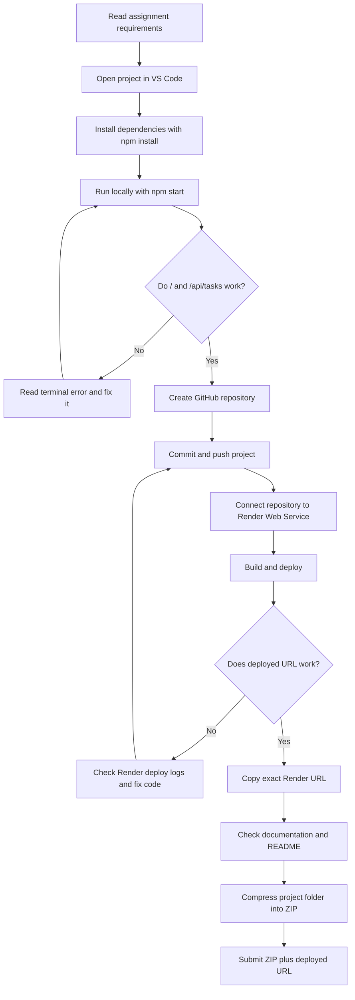

# Assignment Submission Flowchart

## Deliverables

1. **ZIP file:** source code and documentation.
2. **Deployed URL:** exact public Render URL; test `/` and `/api/tasks` before submission.
3. **GitHub repository:** useful for version control and deploy source, but submit its link only if the instructor asks for it.
